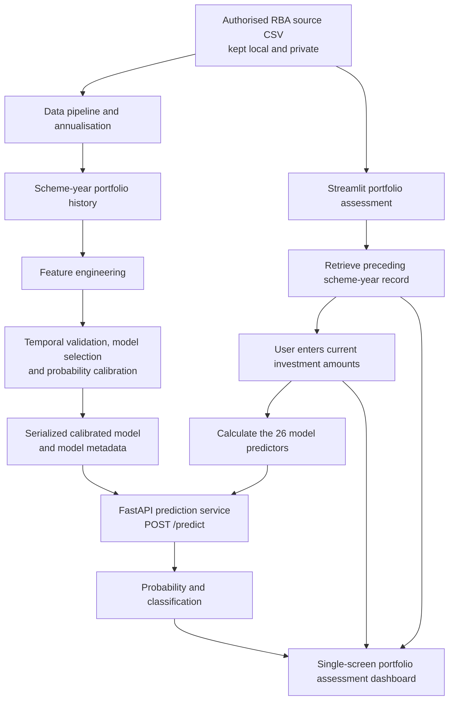

# Pension Asset-Allocation Capstone

**Analysing and Predicting Material Asset-Allocation Transitions among Retirement Benefits Schemes in Kenya**  
DSA 8401 — Applied Machine Learning | MSc Data Science & Analytics | Strathmore University

## 1. Project overview

This project analyses asset-allocation patterns and year-to-year portfolio transitions among Kenyan retirement benefits schemes and develops a machine-learning model to estimate whether a scheme is likely to experience a material asset-allocation change in the next consecutive reporting year.

A **material asset-allocation change** is defined as an absolute change of at least **five percentage points in the share of at least one individual asset class** between consecutive reporting years.

The model's positive classification is an **early-warning decision-support signal**. It is not a finding that a portfolio is harmful, imprudent, unsafe or non-compliant. The model predicts whether a material change is likely to occur in at least one asset class; it does not predict the future monetary value or allocation percentage of each asset class, identify which asset class will change, or predict the direction of that change.

The solution includes a reproducible Python machine-learning pipeline, a FastAPI prediction service, and a single-screen Streamlit application for scheme-level portfolio assessment and early-warning monitoring. The API and dashboard are run together using Docker Compose.

## 2. What the application does

The Streamlit application presents one portfolio assessment workflow and one consolidated results dashboard.

1. The user selects an anonymised scheme reference and the current reporting year.
2. The application retrieves that scheme's immediately preceding annual record from the authorised local RBA source file.
3. The previous-year asset classes and investment amounts are shown as starting values. The user updates the amounts to the current reporting-year values, removes asset classes no longer held, or adds newly held asset classes. Asset classes not selected are treated as zero.
4. The application calculates the portfolio measures and the same 26 predictors used by the trained model.
5. The predictors are submitted to the existing FastAPI `POST /predict` endpoint.
6. The same dashboard displays the previous-versus-current portfolio comparison, asset-allocation changes, concentration and diversification measures, predicted probability, classification and monitoring message.

The application does not train a new model when a portfolio is assessed. It uses the serialized, calibrated model generated by the training pipeline. Per-observation SHAP explanations are not displayed in the dashboard.

### Dashboard outputs

- Previous-year and current-year total investments.
- Number of active asset classes and dominant current asset class.
- Previous-versus-current investment amounts and allocation shares across the nine asset classes.
- Percentage-point changes in allocation shares, including the largest increase and decrease when a change exists.
- Previous and current Herfindahl–Hirschman Index (HHI) and diversification index.
- Calibrated probability of a material allocation change in the next consecutive reporting year.
- Binary classification at the pre-specified 0.50 decision threshold and an appropriately qualified monitoring message.

The user enters current-year amounts only. The previous-year record is retrieved from the private historical source; the user is not expected to calculate the model's 26 predictors manually.

## 3. System architecture



**Main components**

- `src/pension_capstone/`: reusable data preparation, feature engineering, modelling and interpretability modules.
- `scripts/run_training.py`: reproducible end-to-end model training and evaluation entry point.
- `scripts/build_dashboard_data.py`: creates aggregate dashboard summaries from the authorised source data and saved model.
- `scripts/predict.py`: command-line prediction using a prepared row of model predictors.
- `api/`: FastAPI service that loads the calibrated model and accepts prediction requests.
- `dashboard/`: single-screen Streamlit portfolio assessment and monitoring application.
- `models/`: serialized model and model metadata generated by training.
- `reports/`: aggregate model evaluation and data-quality outputs.
- `dashboard_data/`: aggregate dashboard exports; this directory must not contain scheme identifiers or row-level scheme records.
- `tests/`: automated tests for core processing and interactive assessment feature construction.

## 4. Repository structure

The project repository is organised approximately as follows:

```text
AML CAPSTONE PROJECT/
├── README.md
├── AI_USE.md
├── Pension_Asset_Allocation_Capstone.ipynb
├── api/
│   ├── __init__.py
│   ├── main.py
│   └── schemas.py
├── dashboard/
│   ├── __init__.py
│   ├── app.py
│   └── assessment.py
├── dashboard_data/                 # Aggregate exports only; generated locally
├── models/                         # Generated model and metadata
├── reports/                        # Aggregate evaluation reports
├── scripts/
│   ├── build_dashboard_data.py
│   ├── predict.py
│   └── run_training.py
├── src/
│   └── pension_capstone/
│       ├── __init__.py
│       ├── config.py
│       ├── data_pipeline.py
│       ├── feature_engineering.py
│       ├── modeling.py
│       └── interpretability.py
├── tests/
│   ├── test_core.py
│   └── test_interactive_assessment.py
├── requirements.txt
├── api_requirements.txt
├── requirements-dashboard.txt
├── requirements-docker.txt
├── Dockerfile
├── docker-compose.yml
├── .dockerignore
└── .gitignore
```

Generated files may be present inside `models/`, `reports/` and `dashboard_data/`. The raw RBA CSV is a local runtime dependency and is deliberately not part of the public repository.

## 5. Data source and privacy

The project uses anonymised scheme-level investment records obtained from the Retirement Benefits Authority (RBA), covering reporting years 2013–2025. The raw source file used locally is named:

`COPY 1 FINAL.csv`

The raw administrative dataset is **not included in this repository**. A reviewer must have separately authorised access to the source data to reproduce the analysis and application outputs.

For the Docker deployment, `docker-compose.yml` mounts the root-level `COPY 1 FINAL.csv` into the dashboard container at `/private_data/rba_source.csv` as a **read-only runtime file**. The Dockerfile does not copy the raw CSV into the image. The dashboard uses the private source to retrieve the selected scheme's preceding annual record. Scheme-level records are not exported to the aggregate `dashboard_data/` files or saved as assessment outputs by the application.

Do not commit the raw CSV, scheme-level extracts, credentials, or other restricted material. Check the relevant RBA data-use agreement and university requirements before publicly distributing any model artifact or derived output. Permission to share a trained model is separate from permission to share the raw dataset.

## 6. Environment and dependencies

The project was developed and tested with Python 3.13. The Docker image uses `python:3.13-slim`.

From the project root, install the core analysis and modelling dependencies:

```powershell
python -m pip install -r requirements.txt
```

Additional dependency files are used for the services:

- `api_requirements.txt` — FastAPI and Uvicorn for running the API outside Docker.
- `requirements-dashboard.txt` — Streamlit and Requests for running the dashboard outside Docker.
- `requirements-docker.txt` — pinned scientific Python and API dependencies used in the Docker image.

For local development outside Docker, install the relevant additional requirements:

```powershell
python -m pip install -r api_requirements.txt
python -m pip install -r requirements-dashboard.txt
```

## 7. Reproduce the machine-learning pipeline

Run commands from the project root, which contains `scripts/`, `src/`, `models/` and `reports/`.

### 7.1 Train and evaluate the model

If `COPY 1 FINAL.csv` is in the project root:

```powershell
python scripts/run_training.py --data "COPY 1 FINAL.csv"
```

An explicit absolute path can also be supplied:

```powershell
python scripts/run_training.py --data "C:\path\to\COPY 1 FINAL.csv"
```

The training script performs the following steps:

1. Loads the authorised source data and checks the expected source columns.
2. Cleans the reports and annualises the data by retaining the latest report for each scheme-year.
3. Runs financial quality checks and identifies positive-investment scheme-year observations.
4. Constructs asset-allocation shares, HHI, diversification, historical allocation changes and consecutive-year transitions.
5. Constructs the binary next-year target and the 26 predictors.
6. Runs expanding-window temporal validation for outcome years 2020, 2021 and 2022.
7. Selects among Logistic Regression, Random Forest and Gradient Boosting using mean validation Average Precision (PR-AUC).
8. Refits the selected base estimator using outcome years through 2022 and fits sigmoid probability calibration on the separate 2023 outcome year.
9. Evaluates the final calibrated model on the held-out 2024–2025 outcome period.
10. Saves the calibrated model, metadata and aggregate reports, reloads the serialized model and runs a prediction smoke test.
11. Runs optional SHAP feature-importance analysis unless `--skip-shap` is supplied.

To skip the optional SHAP analysis:

```powershell
python scripts/run_training.py --data "COPY 1 FINAL.csv" --skip-shap
```

### 7.2 Temporal model-development design

- Expanding-window validation folds use outcome years 2020, 2021 and 2022.
- Candidate models are Logistic Regression, Random Forest and Gradient Boosting.
- Model selection is based on the unweighted mean Average Precision (PR-AUC) across the three validation folds.
- The selected base estimator is refitted on labelled observations with outcome years through 2022.
- Sigmoid calibration is fitted on the separate 2023 outcome year, with the base estimator frozen.
- The 2024–2025 outcomes are reserved for final held-out testing and are not used for model selection or fitting.
- The pre-specified binary classification threshold is 0.50.

The temporal design allows the same scheme to appear in more than one year. Evaluation therefore concerns prediction for future years among schemes with historical records; it is not an evaluation of generalisation to entirely unseen schemes.

### 7.3 Generate aggregate dashboard data

After the training pipeline has generated the model artifacts, run:

```powershell
python scripts/build_dashboard_data.py --data "COPY 1 FINAL.csv"
```

The script writes aggregate summaries to `dashboard_data/`, including allocation trends, concentration/diversification, observed transitions, held-out prediction summaries, SHAP feature importance and data-quality summaries. The export checks exclude scheme reference identifiers and row-level scheme records.

### 7.4 Run automated tests

Install pytest if it is not already available:

```powershell
python -m pip install pytest
```

Run the complete test suite:

```powershell
python -m pytest tests -q
```

## 8. Run the application with Docker Compose

### 8.1 Confirm local runtime files

Before building the containers, ensure that the project root contains the authorised local file `COPY 1 FINAL.csv` and that the following model artifacts exist:

```text
models/material_allocation_change_model.joblib
models/model_metadata.json
```

If the model artifacts do not exist, run the training pipeline in Section 7.1 first. The raw CSV must remain local and must not be added to the public repository.

### 8.2 Build and start both services

From the project root:

```powershell
docker compose up --build -d
```

Check their status:

```powershell
docker compose ps
```

The API container should report `healthy`; the dashboard container should report `running`.

### 8.3 Open the services

- **Portfolio monitoring and early-warning dashboard:** <http://localhost:8501>
- **FastAPI landing page:** <http://localhost:8000/>
- **API health check:** <http://localhost:8000/health>
- **Interactive API documentation:** <http://localhost:8000/docs>

To inspect service logs:

```powershell
docker compose logs -f
```

To stop the services:

```powershell
docker compose down
```

Docker Desktop must be running. Signing into Docker Hub is not required to build and run this project locally.

## 9. Use the interactive portfolio assessment

1. Open <http://localhost:8501>.
2. Select an anonymised scheme reference and the current reporting year.
3. The application retrieves the selected scheme's immediately preceding annual record from the private source file.
4. Review the previous-year asset classes and starting amounts. Update the amounts to the current reporting-year values, remove classes no longer held, and add any newly held classes. Asset classes not selected are treated as zero.
5. Select **Assess Portfolio**.
6. Review the results displayed together on the same dashboard.

The dashboard shows the previous and current portfolio values, active asset classes, dominant asset class, allocation comparison, percentage-point movements, HHI, diversification index, next-year predicted probability, binary classification and monitoring message.

The dashboard calculates the model's 26 predictor features automatically. The user is not expected to calculate or enter those predictors manually. If there is no valid consecutive previous-year record for the selected scheme and year, the application cannot generate a valid model assessment.

The displayed previous-year amounts are retrieved from the selected scheme's historical record. The current-year amounts are supplied or confirmed by the user; they should represent the scheme's actual current reporting-year values. Hypothetical amounts may be used for software testing only and must not be presented as actual RBA observations.

## 10. API service

The FastAPI service loads the calibrated model and metadata generated by `scripts/run_training.py`.

Available endpoints:

| Method | Endpoint | Purpose |
|---|---|---|
| `GET` | `/` | API service information |
| `GET` | `/health` | Service and model health status |
| `POST` | `/predict` | Accepts one scheme-year observation containing the 26 predictor features and returns a prediction response |

The API request must contain the exact predictor fields defined in `models/model_metadata.json`. Do not submit the target, next-year allocation shares, scheme reference identifiers or other future information as model predictors. The API documentation at `/docs` displays the request schema.

The response includes the selected model, calibrated probability, binary prediction, decision threshold and interpretation information. The interactive dashboard displays the probability and classification but does not display per-observation SHAP explanations.

## 11. Command-line prediction

For a separate command-line prediction, prepare a CSV with one row per scheme-year and the exact 26 predictor columns listed in `models/model_metadata.json`. The values must be calculated only from information available at the prediction date. Do not include `Ref`, target columns, next-year columns or future information.

Run:

```powershell
python scripts/predict.py --input "new_scheme_year_features.csv" --output "predictions.csv"
```

The output contains the predicted probability of material allocation change, predicted class at the 0.50 threshold and the decision threshold used.

## 12. Model outputs and evaluation reports

The training pipeline generates the following artifacts.

**`models/`**

- `material_allocation_change_model.joblib` — fitted preprocessing, selected classifier and sigmoid calibration layer.
- `model_metadata.json` — selected model, predictor names, target definition, temporal partitions and decision threshold.

**`reports/`**

- `data_quality_summary.csv`
- `temporal_validation_results.csv`
- `temporal_validation_summary.csv`
- `heldout_test_results.csv`
- `confusion_summary.csv`
- `calibration_results.csv`
- `sensitivity_analysis.csv`
- `temporal_fold_sizes.json`
- Optional SHAP outputs: `shap_feature_importance.csv`, `shap_summary_bar.png` and `shap_summary_beeswarm.png`.

The aggregate dashboard data builder generates its own summaries under `dashboard_data/`. These are aggregate exports and must not contain scheme reference identifiers or scheme-level row records.

## 13. Interpretation, limitations and responsible use

- The model estimates whether at least one individual asset-class share will change by an absolute five percentage points or more between consecutive reporting years.
- It predicts a binary outcome and its probability; it does not forecast future investment amounts or asset-class shares.
- It does not identify which asset class will change or whether that change will be positive or negative.
- A prediction of class 1 is a monitoring signal only. It is not evidence of harm, imprudence, regulatory breach or non-compliance.
- A 0.50 threshold is used for the reported binary classification. The probability and classification should be considered together.
- The final independent held-out test outcomes cover 2024–2025. A prediction made from 2025 portfolio information for 2026 is beyond that historical test window. It is a prospective research-prototype estimate and must not be described as independently validated 2026 performance.
- The temporal evaluation permits previously observed schemes to recur in later years. It does not establish performance on entirely unseen schemes.
- The system is a research prototype for portfolio monitoring and decision support, not a live regulatory decision system or a substitute for professional assessment.
- Historical retrieval depends on a valid consecutive-year record for the selected anonymised scheme.

## 14. Public repository and artifact-sharing precautions

Before making the GitHub repository public:

1. Confirm that `COPY 1 FINAL.csv` and all scheme-level extracts are excluded from version control.
2. Inspect generated CSVs, JSON files, screenshots, notebooks and test inputs for scheme identifiers, confidential values, credentials or other restricted information.
3. Confirm that the data owner and university permit public distribution of aggregate outputs and the serialized model artifact. Model files can carry information about their training data; permission to publish a model must not be assumed from permission to analyse the source data.
4. The capstone submission requires model training code and serialized artifacts. If a model artifact cannot be made public, agree an authorised alternative for providing it to the reviewer rather than publishing it without permission.
5. Ensure that the README, `AI_USE.md`, source code, tests, Docker configuration and final report or slide deck are included in the repository.

The raw RBA dataset is intentionally accessed locally and is mounted read-only for dashboard use. It must not be copied into the Docker image or uploaded to a public repository.

## 15. Main source modules

- `src/pension_capstone/config.py`: shared project settings, target threshold, temporal periods and source-column configuration.
- `src/pension_capstone/data_pipeline.py`: data ingestion, cleaning, annualisation and financial quality checks.
- `src/pension_capstone/feature_engineering.py`: portfolio measures, consecutive-year transitions, target and predictor construction.
- `src/pension_capstone/modeling.py`: temporal validation, model selection, calibration and held-out evaluation.
- `src/pension_capstone/interpretability.py`: optional global SHAP feature-importance analysis.
- `scripts/run_training.py`: end-to-end training pipeline entry point.
- `scripts/build_dashboard_data.py`: aggregate dashboard export entry point.
- `scripts/predict.py`: command-line prediction entry point.
- `api/main.py` and `api/schemas.py`: FastAPI service and request/response schemas.
- `dashboard/app.py` and `dashboard/assessment.py`: interactive portfolio assessment, feature calculations and single-screen dashboard.

---

**Project status:** Research prototype. See `AI_USE.md` for the disclosure of AI assistance used in developing the project.
